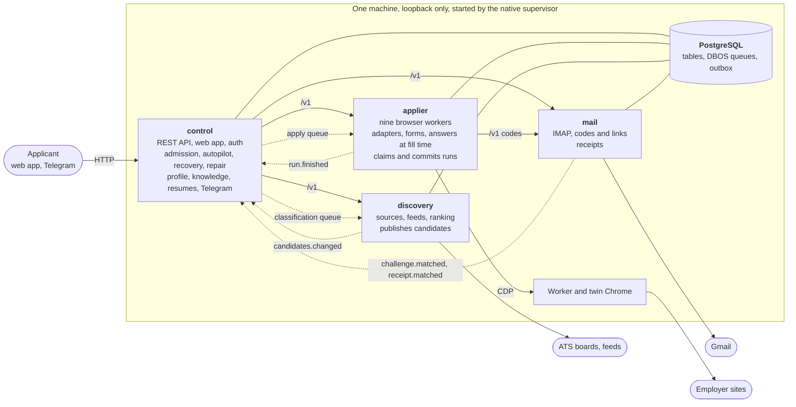

# AXIOM architecture

This is the target design and the plan to reach it. Only phase (a), dead code removal, has started. Until phase (b) lands the
code lives in `jobpilot/`; [RUNTIME.md](RUNTIME.md) describes how it runs today. Numbers are from production on 2026-10-30
and from `main` at `930eb79` unless a line says otherwise.

## 1. The system at a glance

AXIOM applies for jobs on behalf of one person. It finds postings on public applicant-tracking boards and new-grad feeds,
ranks them against the applicant's profile with a model, and fills and submits each application in a real Chrome. It answers
from facts the applicant confirmed, asks when it has no supported answer, and calls an application `confirmed` only with
evidence from the employer: a confirmation page or an authenticated email. It runs on the applicant's own machine, today
one 16 GB Mac, with nine browser workers. Production has recorded 2,974 confirmed runs out of 9,818.



Solid arrows are synchronous HTTP. Dotted arrows are durable, through Postgres. **Nothing calls `control` synchronously**, so
it can restart at any moment, and the synchronous graph has no cycle.

### 1.1 Why it splits here

One Python process runs the API, the scheduler, discovery, the mail poller and every browser, on one event loop and one
interpreter lock. Browser actions run under deadlines of 1 to 12 seconds, so anything that holds the interpreter looks like a
broken widget. This has been the worst recurring production failure:

- **2026-10-12:** `/healthz` took a median 1.5 s and up to 7.9 s. Runs on every ATS died with picker and click timeouts. The
  cause was `receipts.check_receipts` loading 196 MB of packet JSON every minute, plus the autopilot scanning the whole board.
- **2026-10-18 to 19:** 940 field writes missed the 12 s deadline and 70 runs timed out, with a test suite and a Mac on battery
  adding to the load. Overload deadlines cost 223 runs and 37.9 worker-hours across that month's windows.
- **2026-10-20:** the app hung for hours. Among the causes, a tab sweep parsed 22.6 MB of settings every 15 s under the global lock.
- **2026-10-12 to 19:** 139 runs were interrupted because a deploy restarts everything, including a dashboard-only change.
- `grep` finds about 30 more comments in the code citing a stall of this kind. Each was patched where it was found, usually
  with `asyncio.to_thread`, which keeps the event loop free but not the interpreter lock.

Profiling shows where the interpreter goes, attributed by the outermost recognised frame to the service that code would live
in. The first column is `py-spy record --gil --nonblocking` for 120 s at 20 Hz; the second is an earlier profile from a database
investigation, whose capture settings were not recorded:

| Would live in | 2026-10-30 (449 samples, 5 active runs) | 2026-10-29 (936 samples) |
|---|--:|--:|
| `applier`: browser, forms, answers | **15.6%** | **17.2%** |
| `discovery` | 20.0% | 24.6% |
| `control`: API, autopilot, outbox, Telegram | 17.6% | 23.0% |
| `mail` | 9.6% | 11.6% |
| DBOS internals (each process keeps its own) | 19.8% | 11.3% |
| Database driver and loop frames with no application frame | 17.4% | 12.3% |

Browser work holds the interpreter about a sixth of the time, and half or more of it goes to work that does not need to share
a process with browsers. In a separate 90-second window with **no** application running at either end, the database still served 12,227
commits (136 a second) and 77,414 index reads of `runs`. These are small samples and the attribution is a heuristic, but both
profiles and the incident history point the same way.

### 1.2 What the split is and is not

Four processes: `control`, `applier`, `discovery`, `mail`. They share one Postgres with strict write ownership, one image and
one lock file. Six libraries hold what is genuinely shared. This is a small number on purpose:

- **Two would buy most of it.** Separating browsers from everything else is the decisive cut. `discovery` and `mail` earn
  their processes for different reasons: discovery's memory peaks and sweeps, and mail's credentials and independent failure.
  If only one extraction could ever ship, it would be the applier.
- **What it costs.** About 275 MB more at idle, and an estimated 100 to 400 MB more under load, against the 4.6 GB that leaving
  Docker gives back (section 2.6). More to operate, and a contract to keep at each boundary.
- **What it does not fix.** A Mac starved by a test suite is still starved. The engine's own blocking calls stay in the
  applier and need their own fix (phase c). A Mac that sleeps on battery still freezes runs.

## 2. The services

All four are entries in `services.toml`, started by the native supervisor ([NATIVE.md](NATIVE.md)), each a real command with
its own `database_connections`. Docker is a packaging option: the same image with one `command` per service.

### 2.1 `control`

**Purpose.** The control plane and the only thing the applicant talks to. It decides what should happen; it never touches a
browser. It combines what might have been `gateway`, `orchestrator` and `notify`, because nothing in the evidence separates
them: no incident has a dashboard starving the autopilot, or the reverse, and a slow dashboard for one user is acceptable. A
package boundary keeps `gateway` and `orchestrator` apart, so they can become processes the day the API needs replicas.

**Owns.** `runs`, `events`, `reviews`, `budgets`, `profile_snapshots`, the `jobs.status` column group, `resumes`, `rs_masters`,
`rs_artifacts`, all `kn_*` tables, the outbox, and the config and per-job `settings` families (section 3). Files: `resumes/`.

**Public API.** `/v1/*` and, during migration, `/api/*` for the web app. Serves the built web app, `/healthz` and the OAuth
callback. Nothing else calls it.

**Emits.** Enqueues `apply_workflow` for `applier` and `classification_workflow` for `discovery`.
**Consumes.** `run.finished`, `challenge.matched`, `receipt.matched`, `candidates.changed`, and its own `fact.saved`, `tailor`.

**Background loops.** `monitor_scheduler`, the minute tick (`matching` wake, `retry_due`, pending preparations), the
`autopilot_workflow` tick, outbox delivery (four workers, and the 30-second answered-draft sweep), the Telegram main bot and up
to eight worker bots, DBOS retention, heap trim. **Queues consumed:** `matching`, `tailoring`.

**RAM budget.** 350 MB. **`database_connections`:** 20.

**When it is down.** Browsers keep running: in-flight runs finish, queued runs are claimed, commits reserve, outcomes record.
Nothing new is admitted, the dashboard and Telegram are gone, and retries and follow-ups wait in the outbox. Restart costs no
application. This is the first time a dashboard deploy will not touch a run.

### 2.2 `applier`

**Purpose.** The data plane: one job is one tab, driven to a verified outcome. Holds Chrome over CDP, Playwright, adapters,
forms, widgets, CAPTCHA, employer accounts and the resolver.

**Owns.** Employer accounts (`settings['employer_account:*']`, then `employer_accounts`), browser targets (`desktop_job:*`), run
artifacts on disk (`DATA_DIR/runs/`), sessions, and the Chrome profiles. It does not own `runs`, but holds the lease operations
on them (section 3.2).

**Public API.** Deliberately small, and served on its own thread and event loop, never the browsers':
`GET /v1/health`, `GET /v1/status` (workers, pools, loop lag, draining), `GET /v1/accounts`, `GET /v1/accounts/{id}`,
`PUT /v1/accounts/{id}/password`, `DELETE /v1/accounts/{id}`, `POST /v1/browser-sessions`.

**Emits.** `run.finished`, inside the transaction that records the outcome. **Consumes.** Queues `applications_normal`,
`applications_specialist`, `applications_custom`.

**Background loops.** One execution task and one `job_control.watch` per running application; loop-lag sampling
(`host_health.watch`), publishing state every 10 s; the tab sweep; heap trim. On start only: `recover_interrupted`, which only
this process may run, because only it owns browsers.

**RAM budget.** 650 MB, plus 275 MB for the Playwright driver. Chrome is separate: about 2 GB for nine tabs, and 450 MB per
worker at p95. **`database_connections`:** 25. **`drains`:** true.

**When it is down.** Applications stop and resume from checkpoints when it returns; a run mid-commit becomes
`submission_unknown`, which is never blindly resubmitted, exactly as today. Admission sees a stale heartbeat and returns
`applier_unavailable`. The dashboard, discovery and mail keep working.

### 2.3 `discovery`

**Purpose.** Answers "what is worth applying to?". Scrapes about 4,700 sources and curated feeds, deduplicates requisitions,
ranks in batches of 24 with a model, and publishes the result.

**Owns.** `jobs` (posting and ranking columns), `job_listings`, `sources`, `dc_requisitions`, `dc_classifications`,
`dc_source_health`, `dc_deferrals`, the new `dc_candidates`, and the `job_board_*` settings.

**Public API.** `POST /v1/jobs` (import by URL), `POST /v1/jobs/{id}/rank`, `POST /v1/jobs/{id}/enrich`, `GET /v1/board`,
`PUT /v1/board/settings`, `GET|POST|PUT|DELETE /v1/sources`, `POST /v1/sources/{id}/scan`, `POST /v1/scans`, `GET /v1/feeds`,
`POST /v1/feeds/sweeps`, `GET /v1/status`, `GET /v1/requisitions`, `GET /v1/sources/health`.

**Emits.** `candidates.changed`, a wake signal, whenever `dc_candidates` changes. **Consumes.** Queues `discovery`
(`source_workflow`, `feed_workflow`) and `classification`.

**Background loops.** Its own minute tick for due sources and feed sweeps; heap trim. Sweeps parse 13 MB JSON feeds, which is
why its peak is the one worth isolating.

**RAM budget.** 250 MB, with peaks to 400 MB during sweeps. It is stateless between workflows, so a daily restart is a cheap
ceiling. **`database_connections`:** 15. **`required`:** false.

**When it is down.** The board goes stale. `control` keeps admitting from the `dc_candidates` already published, so applications
continue until that supply runs out. Board screens answer with their last data and a `stale` flag.

### 2.4 `mail`

**Purpose.** The only process that reads the mailbox and the only one that holds its credentials in memory. Matches messages to
waiting challenges under its trust checks (authenticated sender, recipient, tenant, time window, single use) and matches
acknowledgements to attempted runs.

**Owns.** `mailboxes`, `mail_rules`, `mail_challenges`, `mail_consumption`, `mail_oauth`, and the `mail_request:*`,
`mail_quarantine:*` and `receipt_poll_cursor` settings.

**Public API.** Challenges for the applier: `POST /v1/challenges`, `GET /v1/challenges/{id}`, `POST /v1/challenges/{id}/wait`
(long poll, returns the code or link), `POST /v1/challenges/{id}/outcome`, `POST /v1/challenges/{id}/persist`,
`POST /v1/challenges/{id}/narrow`, `GET /v1/rules/for?url=`, `POST /v1/rules/ensure`, `POST /v1/rules/discover`,
`POST /v1/rules/{id}/link-origins`. For the owner: `GET /v1/status`, `GET|POST|DELETE /v1/mailboxes`,
`POST /v1/mailboxes/{id}/check`, `POST /v1/oauth/start`, `POST /v1/oauth/callback`, `POST|DELETE /v1/rules`,
`POST /v1/challenges/{id}/cancel`, `POST /v1/receipts/check`.

**Emits.** `challenge.matched` (today's `mail_resume`) and `receipt.matched` (today a direct write to `runs`). **Consumes.** Nothing.
It has no workflows, so it runs **without DBOS**: one less connection pool and notifier thread, and 16 MB less at import.

**Background loops.** The poll loop (`mail_poll_seconds`, default 3), with receipt checks and draft reconciliation.

**RAM budget.** 150 MB. **`database_connections`:** 6. **`required`:** false.

**When it is down.** A run about to open a challenge gets a 503 before it asks the employer to send anything, and parks with its
draft at no cost in starts. A run already waiting times out its long poll and parks as `waiting_email`, a state that exists today.
Runs with no email step are unaffected. Receipts arrive late, not never: the cursor is durable.

### 2.5 Seams that must not become network calls

The hypothesis was "sync reads over HTTP, async through the outbox". Testing it against the code found these exceptions. Local
HTTP costs p50 2.3 ms, p95 9.6 ms, p99 25 ms (FastAPI, uvicorn, httpx over loopback, measured at background priority under load 7
to 9), so latency is rarely the deciding factor. Availability and atomicity are.

| Seam | How often | Decision |
|---|---|---|
| Admission guards and the `runs` insert | Every start; about 1,100 refusals per reconsideration window | Same transaction, in `control`. Over HTTP, guard-then-insert races and the no-duplicates guarantee is gone. Running guards on the applier's interpreter would restore the stall recorded at the top of `service/queueing.py` |
| `reserve_submission`: about ten checks, then `running` to `submitting` | Once per commit, mid-application | One Postgres transaction, in the applier, through the ledger. It must work with `control` down |
| Slot claim, which reads the mail sender lease (`shared_sender_free`, `recovery_sender_ready`) | Every second for every waiting run, under the lock | SQL read of the published view `mail_leases_v`. No HTTP inside a locked transaction |
| Resolver reading knowledge | Per field; a form has dozens, rescanned per page | Library with an in-memory snapshot per run. `kn_facts` is 123 rows and about 1 MB. A `knowledge` service would add a way to kill a run in exchange for nothing |
| Run events | 32 per run on average, peaks near 60 a second | Direct insert-only append |
| Model cost metering | 5 to 13 calls per run | Callback into the ledger |
| Autopilot candidates | Every 15 s, thousands of rows | Published table `dc_candidates`. It removes today's full-board scan and keeps working with `discovery` down |
| Waiting for an emailed code | One challenge per 3.4 runs (2,919 of 9,818) | **HTTP is fine.** One long poll per window |
| Dashboard reads of accounts, boards, mailboxes | A few per poll | **HTTP is fine**, with partial results when an owner is down |

### 2.6 What this costs and buys, in numbers

Import-only RSS on the Mac for each service's closure, measured with today's code at background priority. `jobpilot` imported
whole is 178 MB (164 MB in the Linux container).

| | Idle (measured) | Budget under load (estimate) |
|---|--:|--:|
| `control` | 130 MB | 350 MB |
| `applier` | 130 MB, + driver | 650 MB + 275 MB Playwright driver |
| `discovery` | 114 MB | 250 MB (peak 400 MB) |
| `mail` | 79 MB | 150 MB |
| **Services** | **453 MB** (today 178 MB) | **1,675 MB** (today about 1,575 MB: 1.3 GB plus the driver) |
| Supervisor | 15 MB | 15 MB |
| PostgreSQL (64 MB `shared_buffers`) | | 350 MB (today 255 to 324 MB) |
| Worker and twin Chrome | | 2,000 MB typical; 4,050 MB if all nine reach p95 together |
| **Machine total** | | **about 4.0 GB typical, 6.1 GB worst** |

For comparison, under Docker the VM and its helpers alone cost 6.6 GB. The net cost of the split is **+275 MB idle and an estimated +100 to +400 MB under
load**. The load figures are estimates until phase (d) measures them; the idle figures are not. RSS grows with what a process
does, and one process's fragmentation no longer pins everyone's: the app reached 1.78 GB with 152 threads on 2026-10-30, and read
533 MB six minutes after a restart.

Connections go from a maximum of 50 to 66 (20 + 25 + 15 + 6). The estimate is about 40 open in steady state against about 30 today,
or roughly 50 MB more in Postgres. The same seven DBOS queues poll at the same rate; three notifier threads replace one, each about
1.6% of a core in the 2026-10-30 profile.

**What it buys.** Half or more of interpreter time leaves the browsers' process (section 1.1). Deploys that do not touch a run,
for everything except the applier. A memory peak or crash in discovery or mail that stays there. Mailbox credentials in one
process. A repository whose boundaries a reader can see and CI enforces.

**What it costs beyond RAM.** A failure now has more places to be, so every request and event carries a `run_id` and
`request_id`, and `axiom status` shows all four. An interface change touches a contract. Local development needs the supervisor,
not one command, although `AXIOM_*_MODE=inproc` keeps a single-process mode for tests.

### 2.7 What in-process state breaks

The split silently breaks anything that coordinates through process memory. A scan of module-level mutable state and of `Service`
attributes found these; everything else in the scan is a cache that is safe per process.

| State | Who relies on it across a boundary | Resolution |
|---|---|---|
| `host_health.DRAINING`, `host_health.monitor` | `provider_health.dispatch_limit` during admission | Applier publishes lag and draining to an `applier_status` row (the `host_load_state` mirror already does this every 10 s). Staleness is safe: the claim re-checks in the applier |
| `model_admission.admission`: answers before background model calls | Ranking and answers competed in one queue | Per process. `classification` concurrency stays 1, so ranking cannot crowd answers at the provider |
| `Service.dispatch`, `workers.SERVICE` | 12 modules call `dispatch` | `DBOSClient.enqueue` from `control`, inside the admission transaction where possible, which retires the outbox's `dispatch` kind |
| `service.mail` (13 modules), `service.inbox` | Objects passed through `Service` | `MailClient` interface, in-process then HTTP |
| `Service.__init__`: eight migrations and repairs at construction, `create_all` in `Database` | Every process would race them | One-shot `migrate` service that others wait on. The supervisor's `on-failure` policy already treats exit 0 as ready |
| `recover_interrupted`, `retire_obsolete_deliveries` | Assume one process owns everything | Applier only for the first; each service for its own queues for the second |

`Service` itself mostly hides this. 52 modules reach through it for `service.db` and 38 for `service.config`. Its real interface is
about a dozen methods, and they split cleanly: `queue`, `resolve_review`, `resolve_review_file`, `reconcile`, `resume_mail_wait`,
`resume_review` for `control`; `execute`, `reserve_submission`, `authorize_validation_retry`, `drain` for `applier`. `review_kind`
is a pure function and moves to `domain`.

## 3. Data ownership

**The rules.**

1. Every table has one owner, the only service that may change its schema and, with the two exceptions in 3.2, its rows.
2. A service writes another's data only by calling its API or emitting an event.
3. Reads cross only where 3.4 lists them. Everything else goes through the owner's API.
4. **The database enforces this.** Each service connects as its own role (`axiom_control`, `axiom_applier`, `axiom_discovery`,
   `axiom_mail`) with table and column grants, so a bypass fails with a permission error instead of passing review. This costs
   nothing and needs no second database.
5. Schema changes are Alembic revisions from a single `migrate` step. Today `create_all` cannot alter a column.

### 3.1 Every table

Rows and sizes are from production on 2026-10-30. "Writers today" is an AST scan of attribute assignments, constructors and
`update`/`delete` calls, so treat it as a close lower bound.

| Table | Rows | Size | Owner | Writers today | Who reads it after the split |
|---|--:|--:|---|--:|---|
| `runs` | 9,818 | 1,787 MB | `control`, via the ledger | **15 modules** | `applier` (lease), `mail` (`id, state, job_id`, deadline), `discovery` (`job_id, state`) |
| `jobs` | 17,134 | 85 MB | `discovery`; `status`, `resume_id` are `control`'s | **22 modules** | all |
| `settings` | 62,818 | 46 MB | by key family, 3.3 | **62 modules** | by family |
| `events` | 398,778 | 151 MB | `control`; every service may append | 27 | `applier` (its own run) |
| `reviews` | 720 | 816 kB | `control`, via the ledger | 5 | `applier` writes through `finish` |
| `budgets` | 30 | 64 kB | `control`, via the ledger | 3 | `applier` (reservation), meters everywhere |
| `profile_snapshots` | 281 | 34 MB | `control` | 1 | `applier` |
| `application_outbox` | 28,801 | 13 MB | `control`; every service inserts its own kinds | 1 | each service claims the kinds it consumes |
| `resumes` | 2 | 64 kB | `control` | 2 | `applier`, `discovery` |
| `rs_masters` | 0 | 24 kB | `control` | 1 | none |
| `rs_artifacts` | 14 | 232 kB | `control` | 2 | `applier`, `discovery` |
| `kn_facts` | 123 | 1 MB | `control` | 3 | `applier`, `discovery` (snapshot) |
| `kn_employers` | 64 | 112 kB | `control` | 1 | all |
| `kn_aliases` | 789 | 216 kB | `control` | 1 | all |
| `kn_versions` | 1 | 64 kB | `control` | 1 | `applier`, `discovery` (cache key) |
| `kn_events` | 1 | 48 kB | `control` | 1 | none |
| `kn_migrations` | 254 | 7.4 MB | `control` | 1 | none |
| `job_listings` | 5,149 | 7 MB | `discovery` | 2 | none (`dc_candidates` replaces the tick's read) |
| `sources` | 4,712 | 2.5 MB | `discovery` | 8 | none (API) |
| `dc_requisitions` | 3,291 | 2.8 MB | `discovery` | 1 | none |
| `dc_classifications` | 4,573 | 3.7 MB | `discovery` | 1 | none |
| `dc_source_health` | 4,682 | 1.4 MB | `discovery` | 1 | none (API) |
| `dc_deferrals` | 0 | 16 kB | `discovery` | 1 | none |
| `dc_candidates` | new | | `discovery` | | `control` |
| `mailboxes` | 1 | 280 kB | `mail` | 4 | none (API) |
| `mail_rules` | 980 | 448 kB | `mail` | 2 | `control`, `applier` via `mail_leases_v` |
| `mail_challenges` | 2,919 | 1.5 MB | `mail` | 5 | `control`, `applier` via `mail_leases_v` |
| `mail_consumption` | 814 | 216 kB | `mail` | 1 | none |
| `mail_oauth` | 0 | 16 kB | `mail` | 1 | none |
| `dbos.workflow_status`, `workflow_input`, `workflow_output`, `operation_outputs` | 280,452 and similar | 851 MB | DBOS; each row carries its service's `application_name` | DBOS | DBOS clients. `control` runs retention |
| `dbos.queues`, `workflow_schedules`, `application_versions`, `notifications`, `workflow_events`, `workflow_events_history`, `streams`, `event_dispatch_kv`, `dbos_migrations` | small | 1 MB | DBOS | DBOS | DBOS |

The on-disk stores follow the same rule: `DATA_DIR/runs/` is the applier's, read by `control` through `ledger.artifacts`;
`DATA_DIR/resumes/` is `control`'s; `mail-key` is shared by `mail` and the applier's account store until there is a reason to
split it.

### 3.2 The problem tables

**`runs`: the two exceptions.** The `runs` state machine is written by both `control` and the applier, and no boundary placement
avoids that. Admission must insert in the same transaction as its guards, off the browsers' interpreter. Reservation must work
when `control` is down. So `runs` has one owner and one writing module, `axiom_ledger`, and the applier holds a narrow lease on it.
This is the shape of every Postgres-backed job queue: the scheduler owns the table, and workers lease rows through a library. It is
the one place this design deliberately departs from one service, one writer, and it should be read as such.

The 15 writer modules become 16 named operations, each a compare-and-set:

| Caller | Operations |
|---|---|
| `control` | `admit`, `cancel_queued`, `reconcile`, `resolve_review`, `apply_repair`, `record_receipt`, `schedule_retry` |
| `applier` (lease) | `claim`, `reserve`, `release`, `authorize_validation_retry`, `checkpoint`, `meter`, `append_event`, `finish`, `recover_interrupted` |

The applier's role gets `UPDATE` on named columns and no `INSERT` or `DELETE`; `mail` and `discovery` get no write at all. Today
`mail/polling.py`, `mail/challenges.py` and `receipts.py` write `runs`; `api/routes/runs.py` and `browser.py` do too. Those
writes become `receipt.matched`, `challenge.matched` and ledger calls. `finish` stays one short transaction in the applier, with
policy that needs no browser (recovery scheduling, sensitive-ID closure, review creation) moved behind hooks in the ledger.

**`jobs`: really two tables.** Posting facts and ranking belong to discovery. `status` is two things in one column: the ranking
state (`new`, `ready`, `review`, `skipped`) and a mirror of the latest run (`queued`, `running`, `confirmed`...). Discovery may set
only the first set, from only the first set, in one function; the ledger sets the rest in one function. Column grants enforce
what they can and a contract test the rest. Splitting it physically into `postings` and `applications` is the right end state
and is deferred: 47 modules touch it, and a wrong mirror could re-admit a submitted job.

**`runs.packet`: a god column.** Profile copy, pool, slot, controller policy, recovery and escalation state, in JSON, once 320 KB a
row and 1.4 GB in total. The `db-slim` work removed the profile copies. The remaining fields become columns or `run_recoveries`
as each is touched; it is not a precondition for the split.

**`events`, `application_outbox`, `budgets`.** All append or increment. `events` is insert-only from any service, and retention
is `control`'s. The outbox is the bus: one table, each `kind` has exactly one consumer, and its identity
`sha256(kind:key)` already makes delivery idempotent. Budget spend is an increment; the meter goes through a callback so only the
ledger holds the SQL.

**The one lock.** `Database.exclusive()` (147 call sites) and `set_setting` (133 call sites) all take one advisory lock,
`72319001`. In 24 one-second samples on 2026-10-30 it had no waiters and was held once, so it is not a bottleneck today. But it
would become a cross-process coupling: a discovery `set_setting` would queue ahead of an applier reservation, and a holder stalled
by its own interpreter would stall every service. Phase (c) replaces it with scoped locks: `admission` for the real invariants
(`claim`, `reserve`, `admit`, pacing, slots), `mail` for the sender lease, none for settings, which become row upserts.

### 3.3 `settings` holds about a hundred kinds of record

90 modules touch it and 62 write it. It holds real configuration, but nearly all of its 62,818 rows are per-job and per-run records.
Rule: a key family has one owner, declared in `axiom_core.settings_registry` with a schema, and writing another service's family
raises in tests and logs in production. Families then move to tables, largest first, when their owner is next touched:

| Family | Rows | Owner | Destination |
|---|--:|---|---|
| `job_origin:*` | 17,134 | `discovery` | column on `jobs` |
| `telegram_run_pending`, `telegram_outcome`, `telegram_browser_sent`, `telegram_question_sent`, `telegram_uncertain` | 17,189 | `control` | `notify_state` |
| `failure_report:*` | 6,018 | `control` | `run_reports` |
| `job_board_scan:*`, `job_board_rejected:*` | 8,515 | `discovery` | `dc_scans`, `dc_rejections` |
| `desktop_job:*` | 3,572 | `applier` | `browser_targets` |
| `mail_request:*` | 2,919 | `mail` | column on `mail_challenges` |
| `job_control:*`, `owner_pick:*`, `owner_apply:*` | 2,387 | `control` | `job_controls` |
| `draft_recovery:*`, `repair_*` | 2,665 | `control` | `run_recoveries`, `run_repairs` (applier reads) |
| `employer_account:*` | 565 | `applier` | `employer_accounts` |
| `submission_guard:*`, `historical_company_submissions:*` | 617 | `control` | `submission_guards` (discovery reads) |
| `codex_*_rollout`, `maintenance:*`, `migrated:*` | about 110 | none | delete, or Alembic's history |
| `profile`, `control`, `agent_settings`, `ats_focus`, `application_pacing`, `reserved_employers`, `runner_tiers`, `job_board_settings`, `owner_account`... | about 30 | as named | stay: this is what `settings` is for |

### 3.4 The read contracts

Each is a `SELECT` grant on named columns or a view, and this list is the whole set. It is also the exact work list if a service
ever moves to its own database.

| Reader | Reads | Why not HTTP |
|---|---|---|
| `control` | `jobs` | Admission guards run inside its transaction |
| `control` | `dc_candidates` | Thousands of rows every 15 s; must survive `discovery` being down |
| `control`, `applier` | `mail_leases_v` | Read under the admission lock |
| `applier` | `jobs`, its own `runs`, `events`, `kn_*`, `resumes`, `rs_artifacts`, `profile_snapshots`, config `settings` | Per-field, and must not depend on another process mid-application |
| `discovery` | `kn_facts`, `kn_versions`, `resumes`, `rs_artifacts`, `settings['profile']`, `runs(job_id, state)` | Ranking context and duplicate guards, in bulk |
| `mail` | `runs(id, state, job_id, started_at)` and the deadline, `jobs(id, company, title, url, ats)`, `kn_employers`, `kn_aliases` | Receipt attribution matches thousands of pairs. `employers.resolve` was 30 of 449 interpreter samples, and stops writing on read in phase (c) |

## 4. API conventions

The applicant-facing surface today is 135 route decorators with mixed conventions, reviewed in [API.md](API.md). These rules apply
to every service.

**Versioning.** Every route is under `/v1`. A breaking change means `/v2` beside it, never an edit. `/healthz` is unversioned.

**OpenAPI per service.** FastAPI generates it. `scripts/dev/export_openapi.py` writes `contracts/openapi/<service>.v1.json`, committed,
and CI fails when the file differs from the code or changes incompatibly. `/docs` stays off in production.

**Errors.** RFC 9457 `application/problem+json`, the same everywhere. `detail` is the field today's client already reads, so the
shape is a superset of what `/api/*` returns.

```json
{
  "type": "https://axiom.invalid/errors/worker_capacity",
  "title": "No browser worker is free",
  "status": 409,
  "detail": "All six ATS workers are busy.",
  "code": "worker_capacity",
  "retry_at": "2026-10-30T21:05:00Z",
  "request_id": "01JB..."
}
```

Clients switch on `code`, never on message text; `frontend/src/api.ts` currently recognizes "preparing a tailored resume" by regular
expression. `QueueBlocked` keeps its `code`, `outcome` and `not_before`. Status codes: 400 invalid, 401 not signed in, 403 not allowed, 404
unknown id, 409 conflict with current state, 422 schema, 429 throttled, 202 accepted and deferred, 503 owner unavailable.

**Auth from the web app.** Unchanged: the HttpOnly `jp_session` cookie, `SameSite=Strict`, the Origin check, JSON-only content types.
Only `control` sees the cookie, and it stays the only thing reachable from a browser.

**Auth between services.** Every service binds 127.0.0.1, which the supervisor already requires, and still authenticates. `control`
mints a short-lived token signed with a key from `DATA_DIR/service-key` (`itsdangerous`, already a dependency): `iss`, `aud`, `exp`,
`scope`, and `tenant`, always `default` today. `aud` means a token leaked from discovery cannot call the mail service's mailbox routes.
The claims need no change to carry a real user later.

**Idempotency.** Anything that commits requires an `Idempotency-Key`: apply, answer a review, reconcile, set a password. The key and
response hash live in `idempotency_keys` for 24 hours; a replay returns the first response. Client-side retries become safe, which
they are not over HTTP today. The durable guards still decide: the reservation is a compare-and-set, and an outbox row's identity is
`sha256(kind:key)`.

**Pagination.** Owner lists keep `?page&size&q` returning `{items, total, page, size}`, because a single-user dashboard wants totals and
the tables are small. Append-only streams (events) use `?after=<id>&limit=`. `size` is at most 100 everywhere. `GET` never writes;
today `GET /api/v2/knowledge/facts` writes `kn_facts` through `migration.sync`.

**Generated TypeScript client.** `openapi-typescript` generates types into `web/src/api/generated.ts` from the committed schema of
`control`. The web app only ever calls `control`. CI fails if the generated file is stale, so a contract change breaks the build, not a
screen.

**Today's URLs keep working.** `control/gateway/routes/legacy/` keeps every `/api/*` path, method and body. Of today's 135 decorators,
about 103 are handled by `control` directly, 17 call `discovery`, 10 call `mail` and 5 call `applier`, each through a typed client, never
a blind proxy. Old paths are deleted once the web app has moved and their hit count has been zero for a release. The renames proposed in
[API.md](API.md) section 5 ship as `/v1` from the start, so the old names only exist under `/api`.

**Degraded reads.** `GET /api/snapshot` assembles from each owner with a one-second budget. An owner that does not answer gives
`{"state": "unavailable"}` for its section and a 200 for the rest. A dashboard must not go blank because discovery restarted.

## 5. Repository layout

### 5.1 The tree

A uv workspace: one lock file, one virtualenv, one image, and a `pyproject.toml` per package that declares what it may use, so `playwright`
is a dependency of `axiom-applier` alone. `jobpilot/cli.py` stays as a thin command so `services.toml` has stable commands through the
move.

```
services/
  control/    pyproject.toml  src/axiom_control/{gateway/ orchestrator/ owner/ resumes/ notify/telegram/ ops/ demo/}  tests/
  applier/    pyproject.toml  src/axiom_applier/{worker/ engine/ forms/ widgets/ adapters/ answers/ accounts/ captcha/ mailflow/}  tests/
  discovery/  pyproject.toml  src/axiom_discovery/{sources/ ranking/ board/ ingest/ api/}  tests/
  mail/       pyproject.toml  src/axiom_mail/{challenges polling receipts imap rules transport ...}  tests/
libs/
  core/       axiom_core       config, Database, settings registry, outbox, vault, network, memory. No domain knowledge
  domain/     axiom_domain     Pure vocabulary, no I/O except reads handed to it: Profile, ATS detection, what a question means,
                               posting rules, option matching, mail sender families
  contracts/  axiom_contracts  Request and response models, event schemas, client interfaces with in-process and HTTP implementations
  ledger/     axiom_ledger     The run state machine and its 16 operations; admission types, budget, pacing, slots, pools, recovery decisions
  llm/        axiom_llm        Model clients, admission, provider health, metering callback
  knowledge/  axiom_knowledge  Facts and retrieval: the snapshot the resolver reads, the store control writes through
web/          The React app (today's frontend/), generated client in src/api/generated.ts
desktop/      axiom_desktop: the supervisor, services.toml, release snapshots, Postgres setup. Standard library only
deploy/       docker/ (Dockerfile, compose.yaml), db/roles.sql, alembic/
contracts/    openapi/*.v1.json, committed and checked by CI
docs/         ARCHITECTURE.md RUNTIME.md API.md KNOWLEDGE.md NATIVE.md INFRA.md SETUP.md rea/
scripts/      axiom, setup, deploy, dev/
tests/        contract/ (one suite run against the in-process and HTTP client of each boundary)
              e2e/ (verify, kill-a-service tests)  support/ (synthetic fixtures)
```

Tests sort by what they import: `module_map.py --tests` places today's test files as applier 298, e2e 60, domain 42, core 29, control 26,
discovery 22, mail 18, ledger 12, knowledge 5, desktop 2. The browser marker and `scripts/dev/pytest-locked.sh` carry over.

### 5.2 Boundaries in CI

`import-linter` (2.15) sees function-level imports, which matters because 1,135 of 2,537 import statements here are inside functions. This
exact contract was run against a stub tree with violations planted inside functions, and reported all four: a service importing a service, a
library importing upward, a service importing the mail transport, and the orchestrator importing the gateway.

```ini
[importlinter]
root_packages =
    axiom_control
    axiom_applier
    axiom_discovery
    axiom_mail
    axiom_ledger
    axiom_knowledge
    axiom_llm
    axiom_contracts
    axiom_domain
    axiom_core
include_external_packages = True

[importlinter:contract:services-independent]
name = Services never import each other
type = independence
modules =
    axiom_control
    axiom_applier
    axiom_discovery
    axiom_mail

[importlinter:contract:library-layers]
name = Libraries depend only downwards
type = layers
layers =
    axiom_ledger
    axiom_knowledge
    axiom_llm
    axiom_contracts
    axiom_domain
    axiom_core

[importlinter:contract:libs-never-import-services]
name = No library imports a service
type = forbidden
source_modules =
    axiom_ledger
    axiom_knowledge
    axiom_llm
    axiom_contracts
    axiom_domain
    axiom_core
forbidden_modules =
    axiom_control
    axiom_applier
    axiom_discovery
    axiom_mail

[importlinter:contract:ledger-is-private]
name = Only control and the applier touch the run ledger
type = forbidden
source_modules =
    axiom_discovery
    axiom_mail
forbidden_modules =
    axiom_ledger

[importlinter:contract:browser-only-in-applier]
name = Only the applier may import a browser driver
type = forbidden
source_modules =
    axiom_control
    axiom_discovery
    axiom_mail
    axiom_ledger
    axiom_knowledge
    axiom_domain
    axiom_core
forbidden_modules =
    playwright
    browser_use

[importlinter:contract:mail-holds-the-mailbox]
name = Only mail may import the mail transport
type = forbidden
source_modules =
    axiom_control
    axiom_applier
    axiom_discovery
forbidden_modules =
    axiom_mail.imap
    axiom_mail.transport

[importlinter:contract:gateway-on-orchestrator]
name = Inside control, the gateway sits on the orchestrator
type = layers
containers = axiom_control
layers =
    gateway | notify
    orchestrator | owner | resumes | ops
```

During phase (b), each remaining crossing is listed under `ignore_imports`, generated by `module_map.py`, and that list only shrinks. It is
empty at the end of phase (c).

## 6. The module map

Generated by `scripts/dev/module_map.py`, which reads source with `ast` and exits 1 if any module has no target. It holds an explicit target for
each of the 236 modules, so the map is a set of decisions, not a heuristic. Modules the cleanup branch deletes drop out on the next
`--write`.

<!-- BEGIN GENERATED MODULE-SUMMARY -->
| Owner | Kind | Modules | Lines |
|---|---|--:|--:|
| `control` | service | 66 | 16,274 |
| `applier` | service | 61 | 39,158 |
| `discovery` | service | 12 | 5,254 |
| `mail` | service | 11 | 3,892 |
| `core` | library | 13 | 1,734 |
| `domain` | library | 27 | 5,376 |
| `contracts` | library | 2 | 78 |
| `ledger` | library | 16 | 3,344 |
| `llm` | library | 6 | 1,404 |
| `knowledge` | library | 13 | 3,662 |
| `desktop` | launcher | 9 | 2,517 |
| **Total** | | **236** | **82,693** |
<!-- END GENERATED MODULE-SUMMARY -->

### 6.1 What actually crosses

The first cut of this map forbade the imports in the third column. Most are a pure helper in the wrong module: `widgets.py` is imported by 26
modules, mostly for `norm` and `best_option`. Moving those names to a library (`SYMBOL_MOVES` in the script), and moving code that travels when
its module splits (`IMPORTER_MOVES`), leaves the fourth column. **That is the real coupling, and it is small.**

<!-- BEGIN GENERATED CROSSINGS -->
| From | To | Imports today | After the symbol moves | What is left, by name |
|---|---|--:|--:|---|
| `control` | `discovery` | 26 | 14 | `DcSourceHealth`, `add_job`, `board_snapshot`, `discover_due`, `managed_ids`, `owner_switched`, `posting_api_text`, `rank`, `rank_batch`, and 6 more |
| `applier` | `control` | 12 | 0 |  |
| `control` | `applier` | 11 | 3 | `draft_for`, `one`, `overview`, `save_owner_password`, `summary` |
| `ledger` | `control` | 11 | 0 |  |
| `applier` | `mail` | 9 | 0 |  |
| `core` | `control` | 7 | 0 |  |
| `domain` | `applier` | 6 | 0 |  |
| `control` | `mail` | 5 | 3 | `check_receipts`, `request` |
| `knowledge` | `control` | 5 | 1 | `send_live_questions` |
| `domain` | `knowledge` | 4 | 0 |  |
| `applier` | `discovery` | 3 | 1 | `enrich` |
| `core` | `knowledge` | 3 | 0 |  |
| `discovery` | `applier` | 3 | 0 |  |
| `discovery` | `control` | 3 | 0 |  |
| `ledger` | `applier` | 3 | 0 |  |
| `core` | `discovery` | 2 | 0 |  |
| `domain` | `ledger` | 2 | 0 |  |
| `knowledge` | `applier` | 2 | 0 |  |
| `llm` | `ledger` | 2 | 0 |  |
| `core` | `domain` | 1 | 0 |  |
| `domain` | `mail` | 1 | 0 |  |
| `knowledge` | `ledger` | 1 | 0 |  |
| `ledger` | `mail` | 1 | 0 |  |
| `mail` | `ledger` | 1 | 0 |  |
| **Total** | | **124** | **22** | |
<!-- END GENERATED CROSSINGS -->

Each remaining name has a replacement in section 2: `add_job`, `rank`, `rank_in_thread`, `rank_batch`, `posting_api_text`, `enrich` become discovery's
`/v1/jobs` routes; `board_snapshot`, `managed_ids`, `setup_sources`, `owner_switched`, `DcSourceHealth` its `/v1/board` and `/v1/sources` routes; `ready_applications`, `ready_manual_job_ids`,
`readmit_by_title`, `readmit_by_threshold`, `discover_due` become `dc_candidates` and work discovery does on its own schedule; `overview`, `one`,
`draft_for`, `save_owner_password`, `summary` become the applier's `/v1/accounts`; `check_receipts` becomes `POST /v1/receipts/check`; `request` (the Google token
call) moves behind `/v1/oauth`; and `send_live_questions` becomes an outbox `notify`.

Imports understate one thing. `service.mail` and `service.inbox` carry 25 mail methods to 13 modules with no import at all, so `MailClient` in phase
(c) is the real mail boundary. Table access is the other: section 3.

A rough count of imports suggests heavy coupling between browser code, mail and discovery. Nearly all those edges carry a helper, not a call: after
the moves, the applier makes one import into discovery (`enrich`) and none into mail, and discovery and mail make none into the applier.

### 6.2 Splitting the five giants

Line counts are approximate, taken from the AST. The method is the one that worked for `service.py`, `answers.py` and `mail.py` on 2026-10-20: first a
mechanical cut into a package, with the class assembled from mixins and each moved function's AST compared before and after; then, separately and with
tests beside each change, the long methods become small functions. Comments that cite an incident move with their code, verbatim.

**`forms.py` (6,762 lines) to `applier/forms/`.** `FormSession` spans 5,470 of them. Its longest methods are `fill_current` (646), `_fill` (639), `proof`
(527), `click` (291) and `scan` (268).

| Module | About | Holds |
|---|--:|---|
| `session.py` | 450 | `FormSession` state and contract, keys, write context, stuck-write tracking, `record_answer`, checkpoints, locators |
| `dom_marks.py` | 540 | Page-side marking run during a scan: history rows, status dates, signature dates, phone numbers, account secrets |
| `network.py` | 300 | `NetworkMonitor`: journal, catalog, in-flight requests |
| `values.py` | 300 | Implausible values, prose fitting, confirmation and receipt text helpers |
| `scan.py` | 400 | `scan`, questionnaires, `application_frames` |
| `controls.py` | 420 | `control_action`, `widget_observation`, options, `fill_target`, `set_checked` |
| `fill.py` | 780 | `fill`, `_fill`, comboboxes |
| `fill_page.py` | 960 | `fill_current`, `preselected`, prefill conflicts, catalog answers |
| `options.py` | 190 | `discover_options`, pending and enriched choices |
| `uploads.py` | 400 | Resumes, owner documents, re-upload dialogs, Greenhouse and Workday specifics |
| `dialogs.py` | 200 | Terms, agreements, sign-up forms, consent |
| `phone.py` | 150 | Phone answers and settling |
| `submit.py` | 580 | Submit-control classification, `intermediate_submit`, `click` |
| `verify.py` | 310 | `verify`, error-named fields |
| `proof.py` | 540 | `proof`, evidence context |
| `rejection.py` | 220 | `rejection`, `repair_validation`, inline errors |

**`browser.py` (5,751 lines) to `applier/engine/`.** `BrowserEngine` spans 4,790. `run` (845) and `run_desktop_navigator` (650) dominate.

| Module | About | Holds |
|---|--:|---|
| `engine.py` | 1,000 | `BrowserEngine` state; `run` split into `open_application`, `detect_platform`, `choose_controllers`, `finish` phases |
| `commit.py` | 780 | `reserve_commit`, `_finish`, `watch_submission`, the commit-delivery checks. The safety-critical path gets its own file and tests |
| `draft.py` | 300 | Tab routes, sealing, retention, checkpoints |
| `network_guard.py` | 300 | Request and refusal shapes, header tokens |
| `navigation.py` | 240 | `NavigationDecision`, observation text |
| `flows/navigator.py` | 1,000 | `run_desktop_navigator`, `answer_verdict`, help reviews, stall breaking |
| `flows/guided.py` | 300 | `guided_flow`, `fast_path`, expired entries |
| `flows/adapter.py` | 250 | `run_adapters`, handoffs, Oracle and SuccessFactors recovery |
| `flows/agent.py` | 260 | `run_agent` |
| `challenges.py` | 220 | `browser_challenge`, platform walls, twin tokens |
| `account_step.py` | 200 | `handle_account`, `handle_email` |
| `quality_gate.py` | 160 | `quality_gate`, policy dialogs |
| `trace.py` | 150 | Step trace, form posts |
| `domain:posting/gone.py` | 350 | `posting_gone` and its signals, which the repair agent also needs |

**`widgets.py` (3,766 lines).** This one split gives the most coupling relief in the repository: 26 modules import it, mostly for its pure helpers.

| Module | About | Holds |
|---|--:|---|
| `domain:matching.py` | 620 | `norm`, `best_option`, `same_value`, `parse_date`, money, visa, aliases. No Playwright |
| `widgets/click.py` | 330 | `safe_click`, `human_type`, `pointer_path`, `ensure_uncovered` |
| `widgets/popups.py` | 230 | Option lists, popup scope, scrolling, `click_option` |
| `widgets/dropdown.py` | 250 | `dropdown`, `open_combobox`, `close_picker`, `dismiss_pickers` |
| `widgets/combobox.py` | 300 | `combobox`, `multi_combobox`, Lever location |
| `widgets/prompt.py` | 480 | The Workday prompt family |
| `widgets/basic.py` | 120 | `select`, `checkbox`, `date_parts`, `pills` |
| `widgets/page_state.py` | 60 | Stalled shells, automation ids, origin reset |
| `widgets/phone.py` | 60 | Phone groups |
| `widgets/catalogs.py` | 60 | School and employer "Other" |
| `widgets/ats/recruiting.py` | 260 | `_rcm_*` |
| `widgets/ats/ui5.py` | 470 | UI5 and web components |
| `widgets/ats/icims.py` | 400 | iCIMS dropdowns |

**`adapters/base.py` (3,380 lines) to `adapters/base/`.**

| Module | About | Holds |
|---|--:|---|
| `signals.py` | 430 | Page patterns, reset and create records, `enter_code` |
| `driver.py` | 400 | `Adapter`, `drive`, `classify_page`, `find_*` |
| `steps.py` | 320 | `on_job_details`, `on_form`, `on_review`, `on_confirmation` and the other simple steps |
| `assessment.py` | 110 | Assessments |
| `email_steps.py` | 560 | `on_email_entry`, `on_email_code`, `request_code`, links, mail arming |
| `commit.py` | 320 | `commit`, `click`, `fill_page`, `repair` |
| `auth.py` | 630 | `authenticate`, `recover`, `first_time_route`, `fresh_identity` |
| `password_reset.py` | 590 | `request_reset`, `confirm_one_page_reset`, `set_new_password` |

**`telegram.py` (2,138 lines) to `control/notify/telegram/`.**

| Module | About | Holds |
|---|--:|---|
| `transport.py` | 120 | `api`, downloads, error records |
| `interpret.py` | 300 | Reply models and interpretation |
| `cards.py` | 200 | Keyboards, captions, job cards |
| `questions.py` | 530 | Asking and answering one question at a time |
| `outcomes.py` | 300 | `notify_run`, milestones |
| `updates.py` | 640 | `_handle_update` (425), `chat`, `poll` |

**The trap.** Tests and other modules patch module-level names that every function reads, such as `browser.asyncio`, `browser.navigation_observation`
and `telegram.api`. A split must move those seams and their tests together, which is why these five were left out of the first round. During the rename,
`jobpilot/x.py` becomes `sys.modules[__name__] = axiom_y.x` rather than `from axiom_y.x import *`, so `patch("jobpilot.x.name")` still hits the real module.

### 6.3 Every module

<!-- BEGIN GENERATED MODULE-MAP -->
<details><summary><code>control</code> (service): 66 modules</summary>

| Today (`jobpilot/`) | Lines | Used by | Target | Note |
|---|--:|--:|---|---|
| `cli.py` | 396 | 0 | `cli.py` | split: serve/token/doctor stay; probe, login, browser, twin-browser go to applier:cli.py |
| `demo.py` | 73 | 1 | `demo/seed.py` | Synthetic application for `verify` and the first-run tour |
| `api/__init__.py` | 5 | 1 | `gateway/__init__.py` |  |
| `api/app.py` | 83 | 1 | `gateway/app.py` |  |
| `api/lifespan.py` | 100 | 1 | `gateway/lifespan.py` | One per process afterwards; each service starts only its own loops |
| `api/middleware.py` | 68 | 1 | `gateway/middleware.py` |  |
| `api/pipeline.py` | 407 | 5 | `gateway/pipeline.py` |  |
| `api/routes/__init__.py` | 0 | 0 | `gateway/routes/__init__.py` |  |
| `api/routes/accounts.py` | 118 | 1 | `gateway/routes/accounts.py` | Proxies to applier /v1/accounts |
| `api/routes/archive.py` | 35 | 1 | `gateway/routes/archive.py` |  |
| `api/routes/demo.py` | 76 | 1 | `gateway/routes/demo.py` |  |
| `api/routes/frontend.py` | 32 | 1 | `gateway/routes/frontend.py` |  |
| `api/routes/health.py` | 45 | 1 | `gateway/routes/health.py` |  |
| `api/routes/job_board.py` | 287 | 1 | `gateway/routes/job_board.py` | Proxies to discovery /v1 |
| `api/routes/jobs.py` | 180 | 1 | `gateway/routes/jobs.py` |  |
| `api/routes/knowledge.py` | 57 | 1 | `gateway/routes/knowledge.py` |  |
| `features/knowledge/router.py` | 155 | 1 | `gateway/routes/knowledge_v2.py` |  |
| `api/routes/mail.py` | 121 | 1 | `gateway/routes/mail.py` | Proxies to mail /v1 |
| `api/routes/owner.py` | 282 | 1 | `gateway/routes/owner.py` |  |
| `api/routes/profile.py` | 99 | 1 | `gateway/routes/profile.py` |  |
| `api/routes/queue.py` | 121 | 1 | `gateway/routes/queue.py` |  |
| `api/routes/reserved.py` | 99 | 1 | `gateway/routes/reserved.py` |  |
| `api/routes/resumes.py` | 120 | 1 | `gateway/routes/resumes.py` |  |
| `features/resumes/router.py` | 340 | 1 | `gateway/routes/resumes_v2.py` |  |
| `api/routes/runs.py` | 161 | 1 | `gateway/routes/runs.py` |  |
| `api/routes/session.py` | 35 | 1 | `gateway/routes/session.py` |  |
| `api/routes/settings.py` | 202 | 1 | `gateway/routes/settings.py` |  |
| `api/routes/sources.py` | 73 | 1 | `gateway/routes/sources.py` | Proxies to discovery /v1 |
| `api/routes/state.py` | 64 | 1 | `gateway/routes/state.py` |  |
| `api/sessions.py` | 128 | 4 | `gateway/sessions.py` |  |
| `api/snapshot.py` | 238 | 3 | `gateway/snapshot.py` | Assembled from each owner's status API |
| `telegram.py` | 2,138 | 5 | `notify/telegram/__init__.py` | split: 6.2 |
| `telegram_workers.py` | 406 | 4 | `notify/telegram/worker_bots.py` |  |
| `operations/__init__.py` | 1 | 0 | `ops/__init__.py` |  |
| `operations/cancel.py` | 85 | 0 | `ops/cancel.py` |  |
| `operations/closed_postings.py` | 31 | 1 | `ops/closed_postings.py` |  |
| `operations/reset.py` | 106 | 3 | `ops/reset.py` |  |
| `operations/superseded.py` | 49 | 2 | `ops/superseded.py` | close_superseded_waits runs inside completion and moves to the ledger |
| `service/queueing.py` | 732 | 4 | `orchestrator/admission.py` | _queue becomes an ordered list of guards |
| `archive.py` | 153 | 1 | `orchestrator/archive.py` |  |
| `autopilot.py` | 1,238 | 4 | `orchestrator/autopilot.py` | Reads admission_candidates instead of scanning the board |
| `failure_reports.py` | 146 | 4 | `orchestrator/failure_reports.py` |  |
| `corrections.py` | 38 | 1 | `orchestrator/migrations/corrections.py` | One-time; deleted once Alembic carries a baseline |
| `grandfather.py` | 77 | 1 | `orchestrator/migrations/grandfather.py` | One-time; same |
| `service/migrations.py` | 173 | 1 | `orchestrator/migrations/legacy.py` | Runs at start today; becomes Alembic revisions |
| `execution_services.py` | 454 | 8 | `orchestrator/preparation.py` | split: authoritative_packet moves to knowledge:packet.py |
| `recovery.py` | 799 | 4 | `orchestrator/recovery.py` | split: schedule_recovery runs inside ledger.complete and moves to ledger:recovery.py |
| `repair_agent.py` | 568 | 3 | `orchestrator/repair.py` | Constants the resolver borrows move to domain:answers/masks.py |
| `retention.py` | 105 | 2 | `orchestrator/retention.py` | DBOS retention is a singleton job |
| `service/reviews.py` | 592 | 1 | `orchestrator/reviews.py` |  |
| `workers.py` | 569 | 9 | `orchestrator/schedule.py` | split: each DBOS workflow moves to the service that executes it (section 2) |
| `owner_account.py` | 309 | 4 | `owner/account.py` |  |
| `owner_apply.py` | 202 | 7 | `owner/apply.py` | `picked` moves to ledger:admission.py |
| `owner_questions.py` | 561 | 8 | `owner/questions.py` | split: document_for, generic, row_for are read at fill time and move to domain:answers/owner_view.py |
| `features/resumes/__init__.py` | 50 | 6 | `resumes/__init__.py` |  |
| `features/resumes/claims.py` | 78 | 2 | `resumes/claims.py` |  |
| `features/resumes/compiler.py` | 150 | 2 | `resumes/compiler.py` |  |
| `features/resumes/editor.py` | 327 | 3 | `resumes/editor.py` |  |
| `features/resumes/latex.py` | 128 | 2 | `resumes/latex.py` |  |
| `features/resumes/master.py` | 324 | 2 | `resumes/master.py` |  |
| `features/resumes/pipeline.py` | 525 | 4 | `resumes/pipeline.py` |  |
| `features/resumes/select.py` | 107 | 1 | `resumes/select.py` |  |
| `features/resumes/tailor2.py` | 558 | 1 | `resumes/tailor.py` |  |
| `features/resumes/validate.py` | 64 | 1 | `resumes/validate.py` |  |
| `verify.py` | 163 | 1 | `verify.py` | `axiom verify`, the deployment acceptance check |

</details>

<details><summary><code>applier</code> (service): 61 modules</summary>

| Today (`jobpilot/`) | Lines | Used by | Target | Note |
|---|--:|--:|---|---|
| `accounts/__init__.py` | 90 | 8 | `accounts/__init__.py` |  |
| `accounts/credentials.py` | 140 | 1 | `accounts/credentials.py` |  |
| `accounts/dayforce.py` | 103 | 3 | `accounts/dayforce.py` |  |
| `accounts/errors.py` | 7 | 6 | `accounts/errors.py` |  |
| `accounts/flow.py` | 20 | 1 | `accounts/flow.py` |  |
| `accounts/flow_dayforce.py` | 370 | 1 | `accounts/flow_dayforce.py` |  |
| `accounts/flow_gates.py` | 305 | 1 | `accounts/flow_gates.py` |  |
| `accounts/flow_handle.py` | 579 | 1 | `accounts/flow_handle.py` |  |
| `account_identity.py` | 95 | 2 | `accounts/identity.py` |  |
| `accounts/overview.py` | 228 | 1 | `accounts/overview.py` | Served at applier /v1/accounts |
| `accounts/pages.py` | 107 | 5 | `accounts/pages.py` |  |
| `accounts/store.py` | 333 | 5 | `accounts/store.py` |  |
| `adapters/__init__.py` | 30 | 3 | `adapters/__init__.py` |  |
| `adapters/base.py` | 3,380 | 12 | `adapters/base/__init__.py` | split: 6.2 |
| `adapters/icims.py` | 1,858 | 3 | `adapters/icims/adapter.py` |  |
| `icims_protocol.py` | 243 | 1 | `adapters/icims/protocol.py` |  |
| `adapters/oracle.py` | 179 | 1 | `adapters/oracle.py` |  |
| `adapters/others.py` | 102 | 1 | `adapters/others.py` |  |
| `taleo_protocol.py` | 72 | 1 | `adapters/taleo_protocol.py` |  |
| `adapters/workday.py` | 250 | 2 | `adapters/workday/adapter.py` |  |
| `workday.py` | 1,240 | 2 | `adapters/workday/auth.py` |  |
| `answers/consent_rules.py` | 265 | 1 | `answers/consent_rules.py` |  |
| `answers/demographic_rules.py` | 232 | 1 | `answers/demographic_rules.py` |  |
| `evidence_equivalence.py` | 135 | 2 | `answers/equivalence.py` |  |
| `answers/history_rules.py` | 682 | 1 | `answers/history_rules.py` |  |
| `inference_agent.py` | 241 | 1 | `answers/inference.py` |  |
| `answers/intent_rules.py` | 281 | 1 | `answers/intent_rules.py` |  |
| `letters.py` | 128 | 1 | `answers/letters.py` |  |
| `answers/local_rules.py` | 1,368 | 1 | `answers/local_rules.py` | _local becomes an ordered list of rules |
| `answers/model_batch.py` | 654 | 1 | `answers/model_batch.py` |  |
| `answers/people_rules.py` | 148 | 1 | `answers/people_rules.py` |  |
| `answers/policy_rules.py` | 297 | 1 | `answers/policy_rules.py` |  |
| `answer_quality.py` | 1,065 | 4 | `answers/quality.py` |  |
| `answers/resolver.py` | 803 | 1 | `answers/resolver.py` |  |
| `answers/validate.py` | 454 | 2 | `answers/validate.py` |  |
| `captcha_client.py` | 122 | 1 | `captcha/client.py` |  |
| `captcha_inpage.py` | 136 | 1 | `captcha/inpage.py` |  |
| `captcha_observation.py` | 98 | 7 | `captcha/observation.py` |  |
| `captcha_same_ip.py` | 50 | 1 | `captcha/same_ip.py` |  |
| `captcha.py` | 669 | 2 | `captcha/solver.py` |  |
| `captcha_twin.py` | 190 | 2 | `captcha/twin.py` |  |
| `captcha_visual.py` | 621 | 2 | `captcha/visual.py` |  |
| `browser.py` | 5,751 | 8 | `engine/__init__.py` | split: 6.2 |
| `bot_wall.py` | 58 | 1 | `engine/bot_wall.py` |  |
| `browser_contracts.py` | 187 | 3 | `engine/contracts.py` |  |
| `diagnostics.py` | 452 | 3 | `engine/diagnostics.py` |  |
| `continuous_agent.py` | 767 | 1 | `engine/flows/agent_evidence.py` | The cleanup branch removes drive() and leaves about 80 lines of shared evidence helpers |
| `control_agent.py` | 243 | 1 | `engine/flows/control_agent.py` |  |
| `playwright_fast.py` | 74 | 3 | `engine/playwright_fast.py` |  |
| `posting_read.py` | 101 | 1 | `engine/posting_read.py` |  |
| `privacy.py` | 135 | 5 | `engine/privacy.py` |  |
| `desktop_cdp.py` | 152 | 2 | `engine/tab.py` |  |
| `history_editor_guard.py` | 81 | 3 | `forms/history_editor.py` |  |
| `phone_fields.py` | 150 | 3 | `forms/phone_fields.py` |  |
| `forms.py` | 6,762 | 8 | `forms/session.py` | split: 6.2 |
| `email_browser.py` | 872 | 3 | `mailflow/email_browser.py` |  |
| `inbox.py` | 171 | 4 | `mailflow/inbox.py` | Becomes the in-process, then HTTP, client of the mail service |
| `widgets.py` | 3,766 | 26 | `widgets/__init__.py` | split: 6.2 |
| `widgets_ats.py` | 519 | 2 | `widgets/ats_combo.py` |  |
| `operations/close_tabs.py` | 206 | 1 | `worker/close_tabs.py` |  |
| `service/execution.py` | 341 | 1 | `worker/execution.py` | split: reserve_submission and release_submission move to ledger:reservation.py |

</details>

<details><summary><code>discovery</code> (service): 12 modules</summary>

| Today (`jobpilot/`) | Lines | Used by | Target | Note |
|---|--:|--:|---|---|
| `features/discovery/__init__.py` | 54 | 5 | `__init__.py` |  |
| `features/discovery/router.py` | 119 | 1 | `api/v1.py` |  |
| `jobboard.py` | 1,195 | 9 | `board/__init__.py` | split: settings and sources to board/; scrape_source to sources/; board_snapshot to board/snapshot.py |
| `features/discovery/policy.py` | 251 | 10 | `policy.py` | SENIOR and friends move to domain:posting/seniority.py; gate() is read at admission |
| `discovery.py` | 1,038 | 13 | `ranking/__init__.py` | split: add_job to ingest/jobs.py; rank and rank_batch to ranking/; per-ATS scrapers to sources/; application_entry to domain:ats.py |
| `features/discovery/classify.py` | 193 | 4 | `ranking/classify.py` |  |
| `features/discovery/readiness.py` | 531 | 3 | `readiness.py` | Publishes admission candidates instead of being called by the tick |
| `features/discovery/companies.py` | 427 | 1 | `sources/companies.py` |  |
| `features/discovery/feeds.py` | 879 | 6 | `sources/feeds.py` |  |
| `features/discovery/postings.py` | 227 | 2 | `sources/postings.py` |  |
| `jobsearch.py` | 284 | 2 | `sources/web_search.py` |  |
| `features/discovery/tables.py` | 56 | 6 | `tables.py` |  |

</details>

<details><summary><code>mail</code> (service): 11 modules</summary>

| Today (`jobpilot/`) | Lines | Used by | Target | Note |
|---|--:|--:|---|---|
| `mail/__init__.py` | 110 | 13 | `__init__.py` | Re-exports end; origin, tenant_tokens, employer_label move to domain:mail_identity.py |
| `mail/challenges.py` | 428 | 1 | `challenges.py` |  |
| `mail/constants.py` | 17 | 6 | `constants.py` |  |
| `mail/extraction.py` | 562 | 3 | `extraction.py` |  |
| `gmail_imap.py` | 377 | 5 | `imap.py` |  |
| `mail/mailboxes.py` | 214 | 1 | `mailboxes.py` |  |
| `mail/polling.py` | 555 | 1 | `polling.py` | Writes runs today; emits challenge.matched and receipt.matched instead |
| `receipts.py` | 1,192 | 3 | `receipts.py` | Writes runs today; emits receipt.matched instead |
| `mail/rules.py` | 207 | 1 | `rules.py` |  |
| `mail/service.py` | 32 | 1 | `service.py` |  |
| `mail/transport.py` | 198 | 1 | `transport.py` |  |

</details>

<details><summary><code>core</code> (library): 13 modules</summary>

| Today (`jobpilot/`) | Lines | Used by | Target | Note |
|---|--:|--:|---|---|
| `__init__.py` | 3 | 0 | `__init__.py` | Version only |
| `features/__init__.py` | 19 | 1 | `_retired.py` | Removed: `features` is not a domain |
| `agent_settings.py` | 103 | 19 | `agent_settings.py` | Helper switches every process reads; mail needs them without the LLM clients |
| `config.py` | 360 | 8 | `config.py` | split: one Settings per service over one shared base |
| `connections.py` | 276 | 2 | `connections.py` | Provider keys entered in the dashboard overlay config at start |
| `db.py` | 397 | 100 | `db.py` | split: Database stays; each ORM class moves to its owner's tables.py (section 3) |
| `dbos_sqlite.py` | 24 | 1 | `dbos_sqlite.py` |  |
| `features/_store.py` | 64 | 24 | `feature_store.py` | FeatureBase, digest, norm |
| `memory.py` | 131 | 1 | `memory.py` | Heap trim; every process runs it |
| `network.py` | 64 | 13 | `network.py` | SSRF-safe fetch |
| `outbox.py` | 245 | 8 | `outbox.py` | split: enqueue, claim, retry are the shared bus; deliver() moves to control:orchestrator/delivery.py |
| `runtime.py` | 20 | 11 | `runtime.py` |  |
| `mail/vault.py` | 28 | 2 | `vault.py` | Employer accounts seal with the same key |

</details>

<details><summary><code>domain</code> (library): 27 modules</summary>

| Today (`jobpilot/`) | Lines | Used by | Target | Note |
|---|--:|--:|---|---|
| `accounts/tenants.py` | 104 | 7 | `account_tenants.py` | Mail attributes codes with it too |
| `answer_rules.py` | 290 | 9 | `answer_rules.py` | The owner-editable rule types; schemas.Profile embeds them |
| `answers/__init__.py` | 202 | 13 | `answers/__init__.py` | Re-exports end; callers name the module |
| `answers/consent.py` | 263 | 9 | `answers/consent.py` |  |
| `answers/contact.py` | 172 | 3 | `answers/contact.py` |  |
| `answers/demographics.py` | 62 | 6 | `answers/demographics.py` |  |
| `answers/eligibility.py` | 247 | 8 | `answers/eligibility.py` |  |
| `answers/experience.py` | 289 | 3 | `answers/experience.py` | Years-of-experience questions, from the profile |
| `answers/history.py` | 201 | 9 | `answers/history.py` |  |
| `answers/intents.py` | 225 | 4 | `answers/intents.py` |  |
| `answer_context.py` | 531 | 16 | `answers/propositions.py` |  |
| `answers/sources.py` | 67 | 3 | `answers/sources.py` |  |
| `answers/text.py` | 121 | 15 | `answers/text.py` |  |
| `answers/third_party.py` | 110 | 5 | `answers/third_party.py` |  |
| `ats.py` | 426 | 18 | `ats.py` | Pure URL to platform; imported by 17 modules |
| `email_alias.py` | 108 | 10 | `email_alias.py` | Pure address arithmetic |
| `features/knowledge/models.py` | 142 | 8 | `knowledge_types.py` |  |
| `mail/helpers.py` | 32 | 7 | `mail_identity.py` | Pure helpers both sides of the boundary need |
| `mail/senders.py` | 396 | 6 | `mail_senders.py` | Pure sender families; the applier reads them when it arms a challenge |
| `features/discovery/degree.py` | 142 | 2 | `posting/degree.py` |  |
| `features/discovery/graduation.py` | 168 | 4 | `posting/graduation.py` |  |
| `features/discovery/roles.py` | 174 | 7 | `posting/roles.py` | Pure target-role matching; admission and ranking both ask |
| `features/knowledge/questions.py` | 149 | 5 | `question_identity.py` |  |
| `features/resumes/evidence.py` | 166 | 7 | `resume_evidence.py` | profile_digest is read by admission and ranking |
| `schemas.py` | 301 | 41 | `schemas.py` | split: Profile and history types stay; request models go to contracts:<service>.py |
| `sensitive_ids.py` | 132 | 4 | `sensitive_ids.py` | split: stop_if_sensitive (it touches the page) moves to applier:engine/sensitive.py |
| `shortlinks.py` | 156 | 2 | `shortlinks.py` | Resolved once, at admission and at feed import |

</details>

<details><summary><code>contracts</code> (library): 2 modules</summary>

| Today (`jobpilot/`) | Lines | Used by | Target | Note |
|---|--:|--:|---|---|
| `mail/models.py` | 12 | 2 | `mail.py` |  |
| `mail_errors.py` | 66 | 10 | `mail_errors.py` | MailPending and friends cross the mail boundary |

</details>

<details><summary><code>ledger</code> (library): 16 modules</summary>

| Today (`jobpilot/`) | Lines | Used by | Target | Note |
|---|--:|--:|---|---|
| `service/__init__.py` | 47 | 7 | `_retired_service.py` | split: `Service` ends. control:orchestrator/app.py and applier:worker/app.py assemble what each process needs |
| `admission.py` | 230 | 22 | `admission.py` | QueueBlocked, capacity, employer_partition |
| `application_budget.py` | 126 | 13 | `budget.py` | Allowance, nothing_sent |
| `service/completion.py` | 494 | 2 | `completion.py` | split: policy functions become hooks (section 7, phase b) |
| `controller_policy.py` | 19 | 3 | `controller_policy.py` | Validated at admission, read by the engine |
| `host_health.py` | 397 | 8 | `host_gate.py` | split: HostLoad sampling moves to applier:worker/host_load.py; the published state and Gate stay |
| `job_control.py` | 225 | 10 | `job_control.py` | split: manage() moves to control:owner/job_control.py; watch() to applier:worker/watch.py |
| `application_pacing.py` | 418 | 6 | `pacing.py` |  |
| `pipeline_comparison.py` | 319 | 12 | `pools.py` | split: engine_for moves to applier:worker/engine_choice.py (it imports BrowserEngine) |
| `reserved.py` | 426 | 9 | `reserved.py` | require_approval runs inside the reservation |
| `run_profile.py` | 184 | 6 | `run_profile.py` |  |
| `run_trace.py` | 66 | 1 | `run_trace.py` |  |
| `application_slots.py` | 42 | 2 | `slots.py` |  |
| `specialist.py` | 65 | 5 | `specialist.py` |  |
| `service/states.py` | 21 | 3 | `states.py` |  |
| `tiers.py` | 265 | 8 | `tiers.py` | split: escalate_due moves to control:orchestrator/escalation.py |

</details>

<details><summary><code>llm</code> (library): 6 modules</summary>

| Today (`jobpilot/`) | Lines | Used by | Target | Note |
|---|--:|--:|---|---|
| `model_admission.py` | 109 | 1 | `admission.py` |  |
| `models.py` | 740 | 18 | `client.py` | Writes runs.cost today; the meter goes through a ledger callback |
| `jev.py` | 161 | 1 | `jev.py` |  |
| `prompt_layout.py` | 78 | 3 | `prompt_layout.py` |  |
| `provider_health.py` | 200 | 5 | `provider_health.py` | dispatch_gate moves to ledger:host_gate.py |
| `vision.py` | 116 | 4 | `vision.py` |  |

</details>

<details><summary><code>knowledge</code> (library): 13 modules</summary>

| Today (`jobpilot/`) | Lines | Used by | Target | Note |
|---|--:|--:|---|---|
| `features/knowledge/__init__.py` | 88 | 5 | `__init__.py` |  |
| `features/knowledge/attestations.py` | 84 | 2 | `attestations.py` |  |
| `eligibility.py` | 344 | 3 | `eligibility.py` | Facts versus hiring restrictions; ranking and admission both ask |
| `features/knowledge/employers.py` | 233 | 12 | `employers.py` | resolve() has write side effects; see section 3 |
| `knowledge.py` | 606 | 20 | `legacy_answers.py` | Retired once kn_facts is the one store (API.md D4) |
| `features/knowledge/migration.py` | 331 | 7 | `migration.py` | Moves from read paths to profile save (API.md I4) |
| `profile_photo.py` | 113 | 3 | `profile_photo.py` |  |
| `features/knowledge/questionnaires.py` | 575 | 6 | `questionnaires.py` |  |
| `features/resumes/tables.py` | 61 | 7 | `resume_tables.py` | rs_artifacts is pinned by admission and read by ranking and the engine |
| `features/knowledge/retrieval.py` | 385 | 5 | `retrieval.py` | Served from a per-run snapshot in the applier |
| `features/knowledge/store.py` | 285 | 6 | `store.py` |  |
| `features/knowledge/tables.py` | 89 | 11 | `tables.py` |  |
| `features/knowledge/writing.py` | 468 | 7 | `writing.py` | Role briefs and cover letter text |

</details>

<details><summary><code>desktop</code> (launcher): 9 modules</summary>

| Today (`jobpilot/`) | Lines | Used by | Target | Note |
|---|--:|--:|---|---|
| `native/__init__.py` | 6 | 0 | `__init__.py` |  |
| `native/__main__.py` | 3 | 0 | `__main__.py` |  |
| `native/cli.py` | 490 | 1 | `cli.py` |  |
| `native/env.py` | 198 | 6 | `env.py` |  |
| `native/migrate.py` | 549 | 1 | `migrate.py` | Docker to native; deleted after the cut-over |
| `native/pg.py` | 180 | 3 | `pg.py` |  |
| `native/release.py` | 100 | 2 | `release.py` | Snapshots services/, libs/ and web/ instead of jobpilot/ |
| `native/services.py` | 200 | 2 | `services.py` |  |
| `native/supervisor.py` | 791 | 1 | `supervisor.py` |  |

</details>
<!-- END GENERATED MODULE-MAP -->

## 7. Migration plan

Production stays live throughout, and every phase is deployable on its own with `axiom deploy`, which snapshots a release and rolls back by pointing
`current` at an older one. Behaviour changes never share a commit with a move. Estimates are agent-hours of one agent working, including its test runs on
this machine, and assume at most two or three agents at once under the shared usage limit.

| Phase | Agent-hours | Presentable to YC at the end? |
|---|--:|---|
| (a) Dead code | 3 remaining | The code is honest, but the flat layout is unchanged. Only this document shows the structure |
| (b) Modular monolith | 52 | **Yes.** The tree a reader sees is the target, boundaries fail CI, and it runs as one process |
| (c) Internal contracts | 36 | **Yes, and strong.** `/v1`, OpenAPI per service, a generated client, one writer per table. Still one process |
| (d) Extraction | 36 | **The full story.** Four processes, measured |
| **Total** | **about 127, or 5 to 8 days elapsed** | |

### (a) Dead code removal

In progress on the cleanup branch: 4,171 lines removed so far, including the model-led agent, runner-tier escalation and one-off operations tools.

- **Accept:** fast gate green; `jobpilot verify` on a clean installation; `module_map.py --check` passes.
- **Rollback:** previous release.

### (b) Modular monolith

One process, no behaviour change. Move every module to its target and enforce the boundaries.

| Step | Hours | Work |
|---|--:|---|
| b0 | 3 | `scripts/dev/move.py`: a re-runnable script of `git mv` and import rewrites driven by `module_map.py`. `import-linter` in report-only mode |
| b1 | 6 | `libs/core`, `domain`, `contracts`, `llm`. All `SYMBOL_MOVES`. `widgets.py` helpers first: this dissolves most crossings |
| b2 | 4 | `services/discovery`, `services/mail` packages |
| b3 | 5 | `libs/knowledge`, `libs/ledger` |
| b4 | 5 | `services/control`: gateway, orchestrator, owner, resumes, notify |
| b5 | 4 | `services/applier`: accounts, captcha, answers, adapters, worker. `frontend/` to `web/`, native to `desktop/` |
| b6 | 20 | The five giants: `forms` 6, `browser` 6, `widgets` 3, `adapters/base` 3, `telegram` 2 |
| b7 | 5 | Sort tests by owner, remove shims, make contracts blocking with `ignore_imports` holding the remaining crossings |

- **Accept, per step:** `pytest --collect-only` count unchanged; route table identical; AST of each moved function identical; lines citing a dated incident
  unchanged (1,073 lines cite a date today, checked with `grep`); fast gate green. Before each production deploy: the full suite, one browser file at a time, and `jobpilot verify`.
- **Rollback:** previous release. No schema change in this phase.
- **Sequencing rule:** fixers keep shipping to production during this phase, so each step lands within hours of starting, on the latest `main`, by re-running
  the script. The module being split is frozen only for that step.
- **Skip if the deadline arrives:** b6 can stop after `widgets` (for the coupling) and `forms` (for the reader). The other giants can wait, since they already have a
  named plan.

### (c) Internal contracts

Still one process, with every boundary an interface. In-process clients sit behind them, so a boundary can be exercised and tested without being deployed.

| Step | Hours | Work |
|---|--:|---|
| c1 | 6 | Alembic baseline and the `migrate` step. Scoped locks replace `72319001`. `set_setting` becomes an upsert. Settings registry |
| c2 | 8 | The ledger's 16 operations: 15 writers on `runs` and 22 on `jobs` become one module. Split `jobs.status` writes |
| c3 | 6 | `MailClient`, `DiscoveryClient`, `AccountsClient`: `typing.Protocol` in `contracts`, in-process implementations. `Service` ends; each process assembles what it needs |
| c4 | 5 | Events: `receipt.matched`, `challenge.matched`, `run.finished`. `dc_candidates` in shadow beside `board_snapshot` |
| c5 | 7 | `/v1`, problem+json, idempotency keys, per-service OpenAPI, the generated TypeScript client, `/api/*` legacy routes on the same handlers |
| c6 | 4 | Applier database calls leave the browser loop, through one worker thread and a small async wrapper around the lease operations. This is the fix for the engine's own blocking, which the split cannot provide: `host_health.py` records 38 overloaded periods in 6 hours on 2026-10-29, "most of them the engine's own blocking work" |

- **Accept:** contract suite passes against the in-process clients. A concurrency test on real Postgres: two processes race `claim` and `reserve`, and exactly one wins, every
  time. `dc_candidates` matches `board_snapshot` for 24 hours in shadow. An OpenAPI diff in CI. `import-linter` ignore list empty. No rise in `submission_unknown` or
  `host_load_state` overload periods over a 100-application batch.
- **Rollback:** previous release; schema changes are additive, with old columns kept until phase (d) ends.
- **Skip if the deadline arrives:** the settings-to-tables moves in 3.3 (the registry is enough). c5 should not be skipped: it is what a reader of "API structured" looks for, and it is safe.

### (d) Extraction

One process at a time, least coupled first, each behind `AXIOM_<SERVICE>_MODE=inproc|http`. Each adds a `services.toml` entry and a real command:

```toml
[[service]]
name = "migrate"
command = ["{python}", "-m", "jobpilot.cli", "migrate"]
restart = "on-failure"
after = ["postgres"]
database_connections = 2

[[service]]
name = "mail"
command = ["{python}", "-m", "jobpilot.cli", "serve-mail", "--host", "127.0.0.1", "--port", "{port}"]
port = 8083
health_url = "http://127.0.0.1:{port}/healthz"
after = ["migrate"]
restart_with = ["postgres"]
required = false
database_connections = 6

[[service]]
name = "discovery"
command = ["{python}", "-m", "jobpilot.cli", "serve-discovery", "--host", "127.0.0.1", "--port", "{port}"]
port = 8082
health_url = "http://127.0.0.1:{port}/healthz"
after = ["migrate"]
restart_with = ["postgres"]
required = false
database_connections = 15

[[service]]
name = "applier"
command = ["{python}", "-m", "jobpilot.cli", "serve-applier", "--host", "127.0.0.1", "--port", "{port}"]
port = 8081
health_url = "http://127.0.0.1:{port}/healthz"
after = ["migrate", "worker", "twin"]
restart_with = ["postgres"]
drains = true
database_connections = 25

[[service]]
name = "control"
command = ["{python}", "-m", "jobpilot.cli", "serve", "--host", "127.0.0.1", "--port", "{port}"]
port = 8080
port_setting = "APP_PORT"
health_url = "http://127.0.0.1:{port}/healthz"
after = ["migrate"]
restart_with = ["postgres"]
stop_grace_seconds = 15
database_connections = 20
```

| Step | Hours | Why this order | Relief, from 1.1 |
|---|--:|---|---|
| d0 | 6 | Database roles and grants, run under the integration suite first. `request_id` and `run_id` across services. Service tokens. `axiom status` for four | |
| d1 `mail` | 6 | Fewest crossings (3 imports, plus the `MailClient` surface), no DBOS, nothing else depends on it to start. The practice run | 10 to 12% |
| d2 `discovery` | 10 | Large but independent; `dc_candidates` is already proven in shadow | 20 to 25% |
| d3 `applier` | 14 | Last because it has the most to lose, and by now the machinery has run twice. What is left in the old process is `control` | Separates `control`'s 18 to 23% from the browsers |

**DBOS across processes, verified.** On the pinned 3.2.0, with SQLite as the system database in a scratch test, a `DBOSClient` in one process enqueued by workflow name onto a partitioned queue, and a worker in another process using
`DBOS.listen_queues` executed it. One trap, found the same way: a client constructed with `application_name="axiom-control"` stamps rows with that name, and a worker named
`axiom-applier` never takes them. They sit `ENQUEUED` with no error. Enqueue with the consumer's `application_name`. Each service also gets its own DBOS app name, because dequeuing is
gated on the latest version per name, and without that a discovery deploy would stop the applier's queue. Partitioned queues do not support deduplication IDs, as `workers.py` already notes. Repeat this on Postgres in d0.

- **Accept, per extraction:** the contract suite against the HTTP client. `kill -9` of the extracted service during a live application: the run finishes or parks, and no job is
  submitted twice (`e2e/`). 24 hours at 6 + 2 + 1 workers: no rise in `submission_unknown`, each process within its RAM budget, and for d3, `host_load_state` p95 under the
  0.4 s "loaded" threshold. Deploying `control` during a batch interrupts no run.
- **Rollback:** set the mode back to `inproc` and deploy the prior release's `services.toml`. A release carries its own list, so this is one command. In-process clients stay until
  each service has run stable for two weeks.
- **Skip if the deadline arrives:** d3 is the most valuable and the riskiest, and should not be rushed into a demo window. A repo at d2 is honest and impressive: three processes,
  with the fourth's boundary already enforced.

### If the deadline arrives early

Do (a), b0 to b5, the `widgets` and `forms` splits, b7, c5, the mail parts of c1, c3, c4 and d0, and d1: about 65 agent-hours. That gives the target tree, CI-enforced boundaries, `/v1` with OpenAPI and a generated client, one
service really extracted, and this document describing the rest as a plan already in motion. Never present a phase as done because its directory exists.

### The biggest risk

Phase (b) moves every file while fixes land daily on the same ones. A long-lived branch of moved files cannot merge, and a freeze on `forms.py` stops the fixes that keep the batch running.
The plan therefore treats moves as a script, not a branch: it re-runs on the latest `main`, lands within hours, and freezes one module at a time. If fix traffic makes even that impossible,
stop after b5 and leave the giants whole.

The second risk is the one with an irreversible cost: a duplicate application to a real employer. The design's answer is that the reservation never crosses a process boundary. It stays one
Postgres transaction with a compare-and-set, and the race test in phase (c) must pass before anything is extracted.

## 8. Decisions, and what we will not do

| Decision | Reason |
|---|---|
| **Four services, not dozens** | Each has a measured reason. Further splits buy nothing on one machine for one user |
| **`control` merges gateway, orchestrator and Telegram** | Every starvation incident has browsers as the victim. None has the dashboard and the autopilot harming each other. A package boundary keeps the later split cheap |
| **Admission and autopilot live in `control`, not `discovery`** | `_admit` needs runs, budgets, slots, pacing and the sender lease in one transaction, and imports 31 modules. Discovery supplies candidates and nothing else admission reads |
| **No `notify` service** | Telegram is a second front end onto the same rows, imports 17 modules and would need an API for all of it, at an 80 MB import closure. It costs `control` nothing it does not already have |
| **No `knowledge` service** | Per-field reads of about 1 MB of data. A library with a per-run snapshot is faster than today, and cannot fail mid-application |
| **`runs` keeps two writers, behind one library** | Atomicity is what prevents duplicates. Replacing a transaction with a distributed protocol on a laptop adds risk and removes none |
| **Shared Postgres, per-service roles** | Strict ownership enforced by the database at no RAM cost. A second cluster starts at 200 MB and loses the transactions above |
| **Postgres queues: DBOS and the outbox** | Already here and durable. Rule: work with concurrency limits goes on a DBOS queue; a fact another service must learn goes in the outbox |
| **One image, one lock file, one virtualenv** | Drift between images was a real incident: a `browser-cleanup` container ran five-day-old code beside a fresh app |
| **Native first, Docker as packaging** | Leaving Docker returns 4.6 GB, far more than the split costs |
| **No Kafka, RabbitMQ, Redis or NATS** | The system emits under 100 events a second on one machine. Each would be a new process to keep alive for no property Postgres lacks here |
| **No Kubernetes, service mesh or API gateway product** | One machine and a supervisor that already restarts, orders and reports. mTLS over loopback protects nothing a signed token does not |
| **No gRPC** | Local HTTP is 2.3 ms and the calls are few. JSON keeps OpenAPI, the generated client and `curl` |
| **No per-service database** | It would turn each read contract in 3.4 into a replication problem, and the 16 ledger operations into a saga |
| **No process per browser worker yet** | About 1.2 GB more (130 MB times 9) and CDP connection sharing to rework. Engine work is about a sixth of interpreter time, so try the applier alone first. **Revisit** if `host_load_state` still reports overload at nine workers after phase (c6) |
| **No async SQLAlchemy rewrite** | A rewrite of every query for what one worker thread gets (c6) |
| **No Temporal, or rewriting the engine** | The engine's value is about a thousand dated lessons from real employers, written next to the code they justify. It moves; it is not rewritten |
| **`features/` ends** | It was a provisional name for "the part we rebuilt". Packages are named for what they do |

### What this does not block

**Hosted and multi-user.** Add `tenant_id` to the owned tables and to the existing token claim. `control` becomes replicas plus one `orchestrator` process, a package boundary away. Applier
instances become per-tenant, each with its own Chrome, and the applier's narrow API and lease operations are what they talk through. Postgres can be managed: roles and grants carry over.
**A browser extension.** `engine/tab.py` is the seam: a CDP relay can stand behind it. Moving the automation itself into an extension would mean rewriting the applier, so an extension can only
be an addition. **Per-service databases.** Section 3.4 is the list of what that would take.
